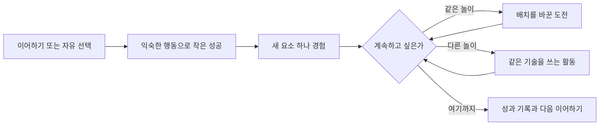
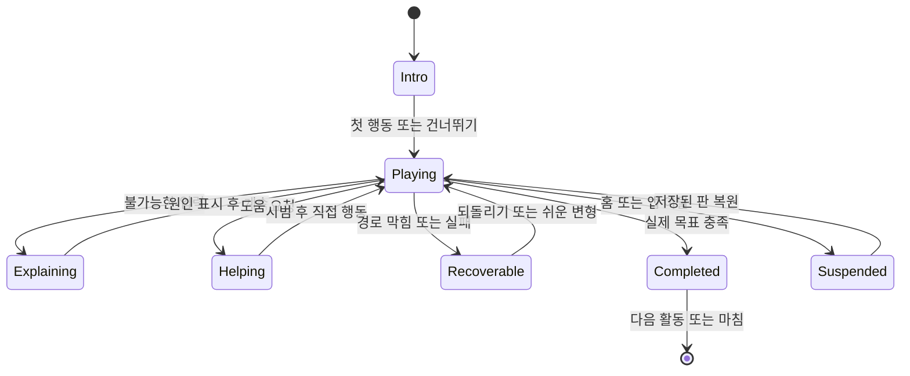

# 어린이체스 제품·경험 설계안

상태: 구현을 위한 기준안. 기존 앱 동작을 변경한 문서가 아니다. 아래 시간·횟수·성공률은 실험할 초기 설정값이며 아동 발달의 보편적 기준이 아니다.

## 1. 누구를 위한 앱인가

“만 6세용”으로 전체를 낮추지 않는다. **체스 이해도, 읽기·조작 도움, 도전 선호를 별도 축**으로 둔다. 연령은 테스트 표본을 나누는 정보이지 난이도를 자동 결정하는 기준이 아니다.

| 이용 상태 | 기본 경험 | 도움 | 깊이 |
|---|---|---|---|
| 처음 만나는 어린이 | 짧은 모험, 1~3행동 성공, 4×4 일부 보드 | 음성·움직임 시범·목표 강조, 되돌리기 | 한 가지 개념씩 |
| 말을 움직일 줄 아는 어린이 | 탐험·소규모 대전 | 요청형 힌트, 체크 구조대 | 2~4수 계획, 짧은 상황 문제 |
| 익숙한 어린이·체스 입문 성인 | 자유 선택, 8×8 대전, 조건 도전 | 도움 개별 설정 | 포크·메이트·최단 경로 |
| 숙련 어린이·성인 | 완주, 더 큰 보드, 동일 시드 기록, 강한 AI | 도움 적게, 필요 시 켜기 | 최적화·전체 투어·고급 전술 |
| 가족이 함께 | 시범→내 차례, 번갈아 두기, 협동 | 부모도 같은 화면으로 안내 | 공동 목표 또는 각자 난이도 |

첫 화면에서 긴 설문을 하지 않는다. 프로필 캐릭터를 고르면 바로 “한 번 움직여 볼까?” 또는 “바로 놀기”를 고른다. 이미 체스를 아는 사람은 학습을 건너뛴다. 도움 설정은 언제든 바꾸고, 도움을 많이 받았다는 이유로 ‘아기 모드’ 같은 낙인을 붙이지 않는다.

## 2. 메뉴와 반복 플레이 흐름

### 홈

```text
┌─────────────────────────────────────┐
│ [내 캐릭터]                  [내 꾸미기] │
│                                     │
│    나이트와 7칸을 더 탐험할까요?        │
│          [이어서 놀기 ▶]              │
│                                     │
│    [모험 🗺] [놀이터 🎲] [대전 ♟]       │
│                                     │
│    방금 배운 룩으로 성을 지켜 볼까요?    │
│          [다른 놀이 보기]             │
│                              [가족 ⚙] │
└─────────────────────────────────────┘
```

- 이어하기에는 실제 저장된 판과 목표를 미리 보여 준다. 저장된 판이 없으면 첫 추천 활동을 표시한다.
- 주 추천은 하나, 다른 선택은 항상 제공한다. 별이 많은 활동만 추천하지 않는다.
- 모든 보드 화면에서 나가면 자동 저장한다. 홈·뒤로는 중단이 가능하며, ‘새로 시작’은 별도의 행동이다.
- 내 꾸미기는 보조 기능으로 두고, 별의 수를 홈의 가장 강한 시각 요소로 만들지 않는다.
- 활동에 들어갈 때 바로 가능한 행동을 보여 준다. 학습 지도 탐색을 거쳐야만 시작하는 구조를 피한다.

### 콘텐츠의 역할

| 현재 메뉴 | 새 위치 | 역할 |
|---|---|---|
| 모험 | 모험 | 개념을 몸으로 배우고 적용 |
| 포획·체크·포크 퍼즐 | 모험의 상황 문제 + 놀이터 ‘한 수 발견’ | 배운 개념의 실제 국면 적용·반복 도전 |
| 나이트 투어 | 놀이터 주력 | 경로 탐험·완주·협동 |
| 디펜스 | 놀이터 주력 | 잡기·대응 순서·웨이브 |
| 별 수집 | 모험의 공통 템플릿 | 이동·경로 계획을 다양한 말로 경험 |
| 폭탄 해제 | 수집 템플릿의 선택 도전 | 남은 이동 수와 우선순위 계획 |
| 서바이벌 | 모험의 안전칸 학습 + 검증 후 놀이터 고급 모드 | 공격선 읽기·위험 예측 |
| 대전 | 대전 | 실제 게임, 가족과 관계, 배운 것 전이 |

홈의 독립 ‘퍼즐’ 메뉴를 없애는 이유는 콘텐츠를 버리기 위해서가 아니다. 처음부터 ‘1수 체크메이트’라는 추상적인 이름을 골라야 하는 부담을 줄이고, 학습 맥락이나 반복 도전 의도를 붙이기 위해서다. 숙련자는 놀이터에서 ‘한 수 발견’을 곧바로 열 수 있다.

### 한 번의 짧은 놀이 예시



예: 룩 두 마리 잡기 → 룩으로 짧은 디펜스 → 배우며 대전에서 룩 사용. 또는 좋아하는 나이트만 여러 판 해도 된다. 활동 연결은 제안이며 강제로 로테이션하지 않는다. 첫 설계에서는 5~12분 정도에도 만족스럽게 한 묶음을 마칠 수 있도록 짧은 판을 만든다.

## 3. 모든 보드가 지킬 경험 규칙

1. **지금 목표 하나:** “별 3개 모으기”, “왕을 안전하게 하기”처럼 행동·대상·진행이 보인다.
2. **가능한 행동과 좋은 행동을 구별:** 이동 가능한 칸이 반드시 안전하거나 최적인 것은 아니다. 입문에서는 안전한 추천을 추가 표시하고, 위험 표시의 뜻을 일관되게 유지한다.
3. **무반응 금지:** 틀린 탭은 판을 잃게 하지 않고 원인을 짧게 보여 준다.
4. **처음 실수는 복구 가능:** 되돌리기·그 자리 시범·조금 쉬운 변형 중 최소 하나가 있다.
5. **한 번에 새 규칙 하나:** 새 말·더 큰 판·움직이는 적·턴 제한을 동시에 추가하지 않는다.
6. **힌트 뒤에도 내가 둔다:** 시범은 미리보기로 보여 주고 원래 판으로 돌아온다. 대신 두기는 사용자가 직접 선택한다.
7. **결과 화면에도 행동:** 같은 놀이 계속하기, 연결된 놀이, 여기까지의 출구가 있다.
8. **규칙 차이는 사전에 눈으로 보인다:** 체스 기물을 활용한 퍼즐의 고정 표적은 ‘연습 말’로 표시한다. 실제 대전의 적과 같은 움직이는 상대처럼 보이게 하지 않는다.

### 시각·소리 언어

| 의미 | 표시 | 예시 음성·문구 |
|---|---|---|
| 선택한 말 | 테두리·바닥 받침 | “룩을 골랐어요.” |
| 이동 후보 | 작은 점 | 최초 1회만 “점으로 갈 수 있어요.” |
| 잡을 수 있는 상대 | 말 바깥의 고리 | “여기로 가면 잡아요.” |
| 이번 목표 | 깃발 또는 수집물 | “깃발로 가요.” |
| 공격받는 곳 | 공격선 + 빗금/방패 깨짐 | “이 길은 상대 룩이 보고 있어요.” |
| 추천 한 수 | 한 개의 화살표 | “이 칸을 살펴볼까요?” |
| 나이트 이동 | 짧은 꺾인 궤적 후 착지 | “두 칸, 옆으로 한 칸.” |
| 성공 | 목표가 채워짐, 짧은 소리 | “왕을 안전하게 했어요!” |

색만으로 뜻을 전달하지 않는다. 음성 없이도 조작 가능해야 하고, 음성은 음소거·다시 듣기를 제공한다. 고정 한국어 안내 음원과 규칙 기반 문구로 충분하다. 모든 턴에 생성형 AI 설명을 호출할 필요가 없다.

일반 텍스트는 행동 하나를 말하는 짧은 문장으로 제한한다. ‘턴’, ‘웨이브’, ‘포크’는 친숙한 행동 표현을 먼저 쓰고 정식 용어를 함께 배운다. 예: “두 말을 한 번에 노려요. 이런 걸 포크라고 해요.”

### 도움 단계

| 단계 | 무엇을 제공하나 | 기록 |
|---|---|---|
| 0 | 스스로 시도 | 독립 해결 |
| 1 | 목표·원인·관련 말 강조 | 관찰 도움 |
| 2 | 후보 범위 또는 한 수 화살표 | 행동 도움 |
| 3 | 한 수 시범 후 원위치 | 시범 도움 |
| 4 | 사용자가 선택한 한 수 대신 두기 / 더 쉬운 변형 | 공동 해결 |

초기 자동화 가설: 유효한 시도가 8초 없으면 도움 버튼만 부드럽게 강조, 같은 원인의 잘못된 이동 2회면 원인 시각화, 같은 문제에서 복구 3회면 ‘같이 해보기’를 제안한다. 생각하는 시간을 실패로 판단하지 않는다. 비활성 탭·화면 읽기·애니메이션 시간은 제외한다. 고급 도전에서는 자동 도움을 끌 수 있다.

## 4. 모험: 말별 문제 묶음에서 기술 연결망으로

권장 순서는 아래와 같지만 대전이나 좋아하는 말은 자유롭게 열 수 있다. 선수 개념을 모르는 경우 긴 설명 대신 해당 화면에서 10초 내외 시범을 제안한다.

| 단원 | 학습 구성 | 연결 활동 |
|---|---|---|
| 길을 움직이기 | 룩 가로·세로, 잡기, 한 번 꺾기, 장애물 | 룩 디펜스 |
| 대각선과 합치기 | 비숍 대각선·같은 색·막힌 길, 퀸의 가로세로·대각선·통합 | 비숍/퀸 수집 |
| 앞으로 가는 폰 | 한 칸, 처음 두 칸, 전진과 잡기 차이, 막힌 앞길, 승격 시범, 적용 | 폰 경주·소규모 판 |
| 뛰어넘는 나이트 | 한 점프, 반대 방향, 장애물 넘기, 두 점프, 별 3개, 다른 시작점 | 나이트 탐험 |
| 왕의 안전 | 한 칸 이동, 공격선 보기, 안전칸, 안전한 포획 | 안전칸 찾기 |
| 왕을 구하기 | 체크 발견, 피하기, 공격자 잡기, 막기, 다른 판에서 선택, 실제 대전 복귀 | 체크 구조대 |
| 작은 체스판 | 내 차례·상대 차례, 상대 응수 보기, 도움을 쓰며 한 판, 스스로 한 판 | 소규모/정규 대전 |
| 발견과 마무리 | 공짜 기물, 잡으면 다시 잡힘, 동시 공격, 체크와 메이트 차이, 1수 메이트, 검증된 2수 메이트 | 한 수 발견·고급 대전 |

각 개념은 **시범 → 같은 배치에서 해보기 → 배치가 바뀐 적용**을 갖는다. 모든 스테이지를 처음부터 3별로 마쳐야 다음 말로 갈 수 있는 구조는 제거한다. 기본 길은 성공 경험을 위한 것이고, 최단 수·무힌트는 옆으로 갈라지는 도전이다.

현재 데이터의 재사용 기준:

- 단순 이동·포획 판은 재배치하고 문구·목표 표시를 수정해 재사용한다.
- 폰 6의 좌표 충돌과 킹의 안전 규칙은 먼저 수정한다.
- 룩 6의 공격선 회피는 기본 룩 길에서 빼고 고급 위협 학습에 재작성한다.
- 비숍 7은 초반 이동 연습이나 휴식 문제로 이동한다. 후반 ‘고급 단계’로 표시하지 않는다.
- 체크/메이트 이름을 붙인 문제는 실제 목적 판정이 있을 때만 그 이름을 사용한다.

### 룩 기본 길: 검증 가능한 8단계 설계

[lesson-examples.json](lesson-examples.json)에 시작점·목표·장애물·최단 수를 넣었다. 앱에 연결하지 않은 설계 데이터다. 별도 BFS로 8개 모두 해법과 최단 수를 검증했다.

| 순서 | 판 | 새로 배우는 것 | 성공 조건 | 안내·복구 | 최단 수 |
|---|---|---|---|---|---:|
| R1 | 4×4 | 가로 직선 | 깃발 도달 | 말과 깃발에 짧은 시범 | 1 |
| R2 | 4×4 | 세로 직선 | 깃발 도달 | 가로로 가도 즉시 실패하지 않음 | 1 |
| R3 | 4×4 | 포획 | 연습 말 1개 잡기 | 포획 고리, 상대는 움직이지 않음을 시각 표시 | 1 |
| R4 | 4×4 | 잡은 뒤 다음 목표 | 연습 말 2개 잡기 | 남은 목표 2→1→0 | 2 |
| R5 | 4×4 | 꺾어서 가기 | 대각선 위치의 깃발 도달 | 대각선 탭에 가로/세로 경로 시범 | 2 |
| R6 | 4×4 | 뛰어넘을 수 없는 장애물 | 우회해 깃발 도달 | 막는 상자를 강조, 한 수 되돌리기 | 3 |
| R7 | 5×5 | 배치가 달라도 적용 | 깃발 도달 | 처음에는 목표만, 요청하면 한 수 | 3 |
| R8 | 5×5 | 선택 도전·순서 계획 | 연습 말 3개 잡기 | 기본 성공 뒤 더 짧은 길 재도전 선택 | 3 |

R7은 새 말이나 적 공격을 추가하지 않고 판만 넓힌다. R8은 선택 도전이다. 학습 판에서는 무제한 이동으로 완료하고, 최단 수 도전은 완료 후에만 강조한다. R8 뒤 추천은 ‘룩으로 성 지키기’ 또는 ‘다른 말 만나기’이며 사용자가 고른다.

### 난이도 데이터와 추천

단일 숫자 레벨 대신 내부 메타데이터로 관리한다.

```text
skills / prerequisites
boardSize / pieceCount / targetCount
newRuleCount / planningDepth / firstMoveChoices
enemyPredictability / moveBudgetSlack
reversible / assistanceAvailable / estimatedDuration
```

`par`가 낮다고 쉬운 문제는 아니다. 룩 6은 최단 3수지만 첫 후보 10개 중 8개가 실패하므로 초보에게 어렵다. 수집 1은 최단 8수에 여유 0수다. 이런 특성을 콘텐츠 검수에 사용한다.

추천은 초기에는 규칙 기반으로 한다. 최근 비슷한 기술 3회 중 2회 이상을 행동 힌트 없이 해결하면 변형을 제안하고, 연속 실패하면 같은 개념의 더 단순한 판을 제안한다. 자동 난이도 하락·상승은 강제하지 않는다. 부모가 대신 둔 판이나 협동 해결을 독립 숙련의 증거로 계산하지 않는다.

## 5. 체크 구조대: 대전 안에서 막힘을 해결하는 핵심 기능

### 시작부터 종료까지

1. 상대 수 애니메이션이 끝나면 마지막 수와 내 킹을 보여 준다.
2. 체크이면 공격하는 말 → 킹의 공격선을 연결하고 “왕이 공격받고 있어요. 먼저 안전하게 해요.”를 짧게 안내한다.
3. 실제 합법수를 계산해 해결 방법을 묶는다. **피하기 / 공격자 잡기 / 사이를 막기 중 현재 가능한 것만 표시**한다.
4. 초보 도움에서는 움직일 수 있는 내 말에 작은 방패 표시를 붙인다. 체스판을 가리는 긴 팝업은 띄우지 않는다.
5. 체크를 풀지 못하는 이동을 시도하면 말을 원위치에 두고, 남는 공격선과 원인을 보여 준다. 차례·시계·기록은 소비하지 않는다.
6. 도움을 누르면 한 방법을 시범으로 보여 준 뒤 아이가 직접 둔다.
7. 체크를 해결하면 “룩으로 길을 막았어요!”처럼 실제 행동을 확인하고 정상 대전으로 돌아온다.

```text
┌ 왕이 공격받고 있어요. 먼저 안전하게 해요. 🔊 ┐
│                체스판                     │
│       공격자 ───────────→ 내 왕             │
│                                          │
│ [왕 피하기]   [길 막기]      [한 수 보기]    │
│ [되돌리기]                  [이어두기 저장] │
└──────────────────────────────────────────┘
```

위 버튼은 해당 국면에서 가능한 방법만 등장한다. 킹을 움직이는 것만 정답으로 오해시키지 않는다. 나이트 체크에는 중간 막기를 제시하지 않고, 더블 체크에는 실제 합법수에 해당하는 킹 이동만 제시한다.

### 움직이지 않는 이유 분류

| 원인 코드 | 화면 반응 | 짧은 안내 |
|---|---|---|
| `wrong-turn` | 현재 차례 패널 강조 | “지금은 친구 차례예요.” |
| `blocked-path` | 경로의 첫 장애 기물 표시 | “이 말이 길을 막고 있어요.” |
| `own-piece` | 도착칸 아군 표시 | “우리 편이 있는 칸이에요.” |
| `piece-pattern` | 선택 말의 이동 모양 1회 | “룩은 가로와 세로로 가요.” |
| `king-in-danger` | 이동 후 남는 공격선 미리보기 | “그곳은 상대 말이 보고 있어요.” |
| `check-unresolved` | 원래 체크 공격선 유지 | “아직 왕이 위험해요.” |
| `exposes-king` | 핀된 말 뒤의 선 표시 | “이 말이 왕을 지키고 있어요.” |
| `game-over` | 결과 상태와 다음 선택 | “이 판은 끝났어요. 한 판 더 할까요?” |

불법 이동 원인은 법적 이동 엔진과 같은 국면에서 계산한다. 모든 합법수를 없애 버리는 별도 교육용 필터를 만들지 않는다. 설명은 결과를 따라야 한다.

### 막힘 유형별 복구

| 상태 | 기본 대응 |
|---|---|
| 체크지만 합법수 있음 | 구조대 유지, 한 수 힌트·시범 |
| 체크메이트 | “왕을 안전하게 할 방법이 없어요. 이번 판은 끝났어요.”; 한 장면 돌아보기·다시 두기 |
| 스테일메이트 | “왕은 안전하지만 움직일 수 있는 말이 없어요. 비겼어요.” |
| 체크 아님, 선택 말만 못 움직임 | 길/아군/핀 이유 설명, 다른 움직일 수 있는 말 표시 |
| AI 응답 지연·오류 | 생각 중 상태, 요청 취소·재시도·검증된 합법수 대체; 무한 대기 금지 |

시범·도움 패널을 보고 있는 동안 연습 시계는 정지한다. 친구 기본 시계는 없음으로 바꾸고, 제한 시간은 고급 선택으로 둔다. 타임아웃의 기본 대응은 도움 제안이다. 기존 자동 수 기능은 ‘시간이 끝나면 도우미가 두기’를 켰을 때 유지하며, 둘 수를 잠깐 표시한다.

### 대전 제공 방식

- **배우며 두기:** 같은 체스 규칙, 체크 구조대·되돌리기·마지막 수 표시·짧은 설명.
- **컴퓨터와:** 상대 5난이도와 도움 수준을 별도로 선택. 기본 난이도 명칭을 ELO 실력처럼 주장하지 않는다.
- **가족과:** 마주 보기/같은 쪽에서 보기, 시계 없음 기본, 되돌리기 요청은 양쪽이 확인.
- **짧은 판:** 적은 말로 시작하는 검증된 국면. 체크메이트 대전과 ‘기물 2개 잡기’ 같은 목표 게임은 다른 승리 조건을 명확히 표시한다.
- **도전 대전:** 표준 규칙, 요청형 도움, 승격 선택·캐슬링. 초보 설정에서 퀸 자동 추천은 가능하되 선택 가능하게 한다.

컴퓨터전 되돌리기는 내 수와 상대 응수를 한 묶음으로 되돌려 다시 내 차례가 되게 한다. 사람전은 한 수 단위와 차례를 명시한다. 캐슬링 권리·앙파상·반복국면·50수 카운트까지 함께 복원한다.

체크 회피·포획·막기·나이트 체크·더블 체크·핀·메이트·스테일메이트의 8개 [국면 예제](lesson-examples.json)를 독립 규칙 라이브러리로 검증했다. 이 예제는 구조대 구현·테스트의 출발점이며 실제 수업 전체를 완성한 데이터는 아니다.

## 6. 나이트 탐험: 어린이의 짧은 성공과 어른의 완주를 함께

### 세 가지 목표

| 모드 | 성공 조건 | 되돌리기·힌트 | 추천 대상 |
|---|---|---|---|
| 산책 | 미리 정한 3~5회 점프로 깃발 도달 또는 별 3개 | 무제한 되돌리기, 한 수 시범, 필요 시 재방문 허용을 명시 | 처음 점프하는 사람 |
| 탐험 | 검증된 작은 경로/영역의 8~12칸 방문 | 갈림길에서 복구 가능, 한 수 힌트 | 규칙을 익힌 사람 |
| 완주 | 현재 5×5·6×6·7×7 전 칸 1회 방문 | 도움 켜기 가능, 도움 기록과 무도움 기록 구분 | 숙련 어린이·성인 |

산책을 단순히 3×3 전체 투어로 줄이지 않는다. 작은 보드라고 전체 투어가 항상 가능한 것이 아니다. 해법이 검증된 짧은 경로를 먼저 만든 뒤 목표를 놓는다.

전체 완주는 계속 선택할 수 있다. 아이가 부모의 완주 놀이를 좋아한다면 쉬운 모드로 강제 이동시키지 않는다.

### 갈림길·실패·별의 재설계

- 입문 별은 완료 가능한 경로와 양립하도록 배치한다. 별을 향한 자연스러운 선택이 숨은 실패를 만들지 않게 한다.
- 완주 도전에서 무작위 별을 유지하려면 ‘점수 탐험’과 ‘완주’ 목표를 분리하거나, 별 때문에 해법이 막히지 않는 배치임을 검증한다.
- 경고 문구는 “잘못 가면 못 끝내요”보다 “여기서 길이 나뉘어요. 막히면 돌아올 수 있어요.”로 바꾼다.
- 막히면 방금 막힌 연결을 보여 주고 **되돌아갈 갈림길**을 제안한다. 입문에서는 회복 가능한 상태까지 되돌릴 수 있다.
- 전체 정답 경로는 고급 ‘경로 펼쳐 보기’로 남기고 기본은 다음 한 점프만 표시한다. 나이트의 이동 그림은 직선 대각선 화살표로 오해되지 않게 꺾인 경로·점프로 표현한다.
- 부분 성취는 “오늘 14칸을 탐험했어요”로 기록한다. 14칸을 전체 완주로 표시하지 않는다. 개인 최고 기록은 단순 별 개수와 분리한다.
- 힌트 후 이동하면 사용한 힌트는 지우고, 새 상태에서 다시 계산한다. 탐색 한도 초과를 불가능이라고 말하지 않는다.

### 가족 놀이

1. **한 번 보여주기:** 부모가 1~2수 시범, 같은 시작 상태로 돌려 아이가 시도. 부모 시범을 아이의 독립 성공으로 기록하지 않는다.
2. **번갈아 탐험:** 같은 판에서 색이 다른 발자국으로 번갈아 한 수. 공동 완주·되돌리기 가능.
3. **같은 판 도전:** 동일 시드로 각자 플레이. 아이는 방문 칸, 어른은 완주·도움 없이 같은 판을 즐긴다. 단일 점수로 둘을 직접 서열화하지 않는다.

## 7. 나머지 놀이의 구체적 정리

### 디펜스

- 첫 판은 룩 하나·적 하나, 다음 판은 적 둘, 그다음에 웨이브를 추가한다.
- 적의 다음 칸을 반투명 발자국으로 보여 준다. 적은 차례대로 짧게 움직여 원인과 결과를 읽을 수 있게 한다.
- 하트 2개와 경계선을 표시하고, 경계 도달/통과 중 하나로 판정을 통일한다. 권장: 표시된 마지막 줄에 들어오면 돌파.
- 고정된 침입 경로를 쓰는 적은 연습 인형·침입자 배지로 표시한다. 실제 체스의 자유 이동·공격과 다름을 첫 등장 시 짧게 보여 준다.
- 충돌·포획 순서를 명세하고 중복 점유를 금지한다. 라운드 중 생성은 미리 예고한다.
- 클리어와 완벽 방어를 구분한다. “성을 지켰어요. 한 번 지나갔지만 끝까지 막았네요.” 같은 사실에 맞는 결과를 준다.
- 어린이용은 짧은 1~3웨이브, 고급은 같은 규칙으로 더 복잡한 배치·최소 손실을 추구한다.

### 별 수집·제한 수 도전

- 공통 경로 게임 엔진으로 합친다. 목표는 별 수집, 추가 규칙은 순찰·제한 수 등 메타데이터로 표현한다.
- 입문에는 제한 수가 없다. 제한 수는 기본 성공 뒤 도전으로 제안한다.
- 현재 수집 1은 별 하나→두 개→세 개로 분리하고, 나이트 이동을 처음 익히는 판에 8수 전체 계획을 요구하지 않는다.
- 순찰의 다음 위치를 보여 준다. 적은 접촉만 위험한지 공격선도 위험한지 정하고 서로 다른 기호를 쓴다. 권장 입문은 체스 적 대신 순찰 장애물로 시각 구분한다.
- 제한은 ‘남은 이동 4번’처럼 표시하고 실제 벽시계 시간과 구분한다.
- 폭탄 테마가 재미있는 사용자는 선택해 쓸 수 있다. 테마 교체가 난이도·판정 오류를 대신 해결해 주지는 않는다.

### 안전칸·서바이벌

- 먼저 고정 공격선 한 개에서 안전한 곳으로 이동하는 성공형 문제를 제공한다.
- 다음으로 적 한 수의 예고를 보여 주고 움직이게 한다. 새 적의 무작위 생성은 초보 판에서 제거한다.
- 기다리기는 별도의 ‘기다려요’ 버튼으로 설명한다. 실제 대전에서는 차례를 그냥 넘길 수 없다는 차이를 명시한다.
- ‘오래 살아남기’는 고급 놀이로 분리한다. 막히는 결과가 무작위 생성 때문인지 선택 때문인지 설명할 수 있어야 출시한다.
- 다음 단계 해금은 게임오버 순간에만 일어나게 하지 않는다. 목표 턴 달성 시 계속/마무리 선택을 제공한다.

### 한 수 발견

- 입문 순서: 포획 → 포획 후 안전 → 체크 해결 → 체크 만들기 → 메이트 → 동시 공격 → 2수 문제. 실제 테스트에 따라 포크와 메이트 순서는 조절 가능하다.
- “왕을 가둘 수 있을까?”처럼 목표를 보드에 붙인다. 처음부터 좌표·기보 암기를 요구하지 않는다.
- 목표를 만족하는 모든 답을 허용하거나, 문제를 ‘특정 말을 쓰는 도전’으로 명확히 한정한다.
- 오답은 한 장면 설명 후 바로 되돌아가 다른 수를 둘 수 있다. 전체 화면 초기화만 요구하지 않는다.
- 여러 수 문제는 상대 응수 트리와 대체 정답을 검증한다. 설명용 대표 응수와 ‘어떤 응수에도 성립하는 해법’을 구분한다.
- 최종판의 메이트는 실제 국면으로 확인한다. `solution` 배열 종료를 성공 조건으로 삼지 않는다.

## 8. 보상과 다음 행동

공통 의미를 먼저 정한다.

- **완료 도장:** 도움을 받아도 목표를 달성하면 제공. 기본 콘텐츠 진행을 연다.
- **도전 메달:** 특정 검증된 조건(최단 수, 도움 없이, 전 칸 방문 등)을 달성했을 때만 제공. 조건을 시작 전에 보여 준다.
- **스킨용 별:** 새 활동·새 기술 도장 등 예측 가능한 성취로 받는다. 도움을 썼다고 이미 받은 별을 빼지 않는다.
- 나이트 점수·디펜스 기록은 해당 게임의 기록이다. 스킨 별과 다른 아이콘·이름을 사용한다.
- 대전은 승리만 보상하지 않는다. 첫 체크 탈출, 한 판 마무리 같은 한정된 성취도 인정한다. 같은 행동을 반복해 별을 무한히 얻는 구조는 피한다.

기존 별과 해금 스킨은 보존한다. 새 규칙에서 더 적은 별을 받을 상황이어도 소급 차감하지 않는다. 이전 성공이 오류 문제에서 나온 것이라도 아이에게 책임을 돌리거나 해금을 빼앗지 않는다.

결과 화면:

```text
왕을 안전하게 했어요!  [내가 둔 마지막 한 수 그림]
룩이 길을 막아서 왕을 지켰어요.

[이어서 두기]  ← 방금 대전 중이었다면 원래 판으로
[한 번 더 해보기] 또는 [여기까지]

새 꾸미기를 얻었다면 [지금 입혀보기]
```

다음 추천은 방금 사용한 기술과 선호에 연결한다. 매번 낯선 콘텐츠로 보내지 않는다. 연속 출석 압박·무작위 보상·실패 직후 상점 유도는 이번 제품 목표에 필요하지 않다.

## 9. 상태·코드·저장 설계

### 공통 상태



`Animating`·`OpponentThinking`은 세션의 입력 잠금 하위 상태로 관리한다. 화면 이탈 시 토큰을 무효화하고 타이머·Worker 응답·음성·팝업을 정리한다. 단일 전역 `animating`에 모든 모드를 의존시키지 않는다.

### 필요한 공통 계층

| 계층 | 책임 | 현재 파일에서의 이동 |
|---|---|---|
| 규칙 | 이동·공격·합법성·종료·이유 코드 | `chess.js`, 각 미니 이동 함수 |
| 활동 목표 | reach/capture/check-resolved/mate/visit/defend 판정 | 각 클릭 핸들러의 성공 검사 |
| 세션 | 이력, 되돌리기, 진행 저장, 입력 잠금, 화면 이탈 | `app-core.js`와 각 state |
| 보드 | 크기·기물·목표·공격선·애니메이션·접근성 | 반복되는 보드 HTML |
| 도움 | 활성 화면의 목표·한 수·시범·불가능 복구 | 공통 힌트 및 각 Hint 함수 |
| 진행 | 도장·도전·별·스킨·추천 | `missions.js`, `app-home.js` |

처음부터 프레임워크를 갈아엎지 않는다. 현재 정적 앱 안에서 순수 함수와 모듈 경계를 추출한다. 표준 체스와 아케이드 변형은 명시적인 `ruleset`으로 분리하되 공통 이동 형태·보드 표시는 재사용한다.

### 콘텐츠 스키마 예시

```json
{
  "id": "rook.obstacle.v1",
  "contentVersion": 1,
  "ruleset": "movement-lab",
  "skills": ["rook-line", "blocked-path"],
  "prerequisites": ["rook-turn"],
  "objective": {"type": "reach", "target": [3, 3]},
  "difficulty": {"planningDepth": 3, "newRuleCount": 1},
  "challenge": {"type": "minimum-moves", "par": 3},
  "support": {"undo": true, "demo": true, "voiceKey": "rook.go-around"},
  "validation": {"mustBeSolvable": true, "challengeMustBeReachable": true}
}
```

### 진행 저장

```text
profiles/{id}
  preferences: voice, motion, support, theme, favoriteActivities
  skills: skillId -> seen / assisted / independent / transferred
  completions: contentId + version -> seal, challenges, bestRecord
  collection: starsEarned, unlockedSkins
sessions/{profileId}/{activityId}
  rulesetVersion, contentVersion, seed, board, turn, moveHistory
  objectiveState, hintsUsed, timers, rngState, updatedAt
```

- 배열 위치를 영구 ID로 사용하지 않는다.
- 기존 0-based 인덱스를 현재 콘텐츠 ID로 매핑해 마이그레이션한다. 재배치 전에 매핑표와 구버전 사본을 만든다.
- 가족 공용 저장을 유지하되 프로필별 숙련·진행을 분리한다. 시범 세션은 별도 표시한다.
- 마이그레이션 실패 시 기존 데이터를 그대로 두고 읽기 가능한 상태로 복구한다.
- 오프라인과 저장 실패를 고려한다. 저장 불가라면 화면 안에 짧게 알리고 판은 계속할 수 있게 한다.
- 새 서비스워커는 완료 화면/홈 등 저장된 안전한 시점에 적용한다.

## 10. 반응형·접근성 설계

- 휴대폰은 목표·보드·핵심 버튼이 우선, 설정은 접는다. 보드 밖 장식 때문에 현재 목표가 밀려나지 않게 한다.
- 태블릿·PC는 큰 보드와 옆 도움 패널을 활용한다. 가족 마주 보기는 양쪽 패널과 기물 방향을 지원한다.
- 보드 칸을 의미 있는 포커스 대상으로 제공한다. 기물·진영·좌표·선택 상태·가능 이동을 읽을 수 있게 한다.
- 주요 버튼은 넉넉한 터치 영역을 확보하고 작은 휴대폰 8×8 판은 실기기 오탭률로 검증한다. 일률적으로 칸을 48px로 고정해 화면 밖으로 밀지 않는다.
- 확대를 허용하고, 음성·색·움직임 중 하나에만 정보를 의존시키지 않는다. 동작 감소 옵션을 지원한다.
- 모든 스킨은 고정된 기물 배지·내 편 표시를 가진다. 클래식 스킨을 읽기 쉬운 선택지로 제공한다.

## 11. 설계의 완료와 남은 검증

메뉴·콘텐츠 역할·학습 순서·도움·체크·나이트·가족·보상·상태·데이터의 구현 방향은 이 문서를 기준으로 삼을 수 있다. 룩 8판과 규칙 국면 8개는 검증된 예시까지 있다.

다만 모든 신규 단원의 최종 배치, 실제 음성·그림, 기기별 픽셀 설계, 즐거움과 적정 도움 빈도는 플레이테스트 후 확정해야 한다. 이를 이미 검증된 완성품으로 취급하지 않는다. 구체적인 착수 순서와 출하 조건은 [BACKLOG.md](BACKLOG.md)에 둔다.
