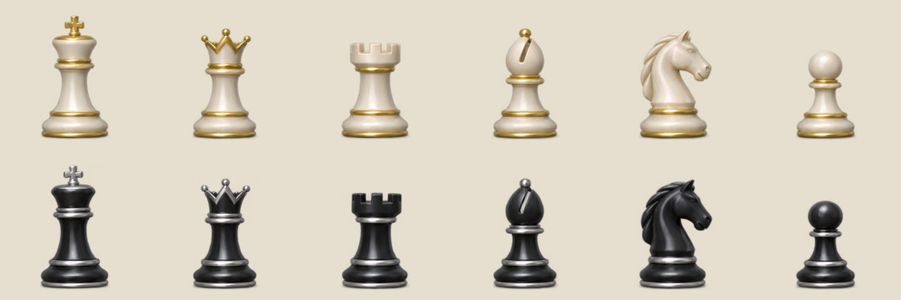
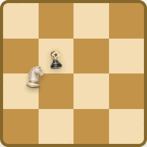

# 로열 클래식

홈 → 꾸미기 → 말 → **로열 클래식**을 선택한다. 별 0개부터 무료이며 앱 판에서도 사용할 수 있다. 선택 후 공방의 **♞ 말 모션 보기**에서 나이트의 점프·공격과 폰의 피격을 바로 확인할 수 있다.

GIF는 관찰을 위해 느리게 녹화했다. 실제 게임의 일반 이동은 약 0.49초, 잡기는 약 0.58초다. 이동·공격·피격·착지 효과는 새 스킨에만 적용하며 기존 스킨의 그림과 이동 방식은 유지한다. 선택한 말에는 작은 대기 모션이 있다. 앱의 모션 끄기와 OS의 동작 줄이기 설정을 따른다.

## 이미지 제작

- 내장 `image_gen` 도구를 **1회** 호출했다. 추가 생성이나 API 호출은 없다.
- 정확한 요청문: [image-prompt.txt](image-prompt.txt).
- 생성 원본: [source-atlas.png](source-atlas.png), 1254×1254, 투명 배경.
- 전체 36포즈: [contact-sheet.jpg](contact-sheet.jpg).
- 런타임: `icons/skins/royal-classic/atlas.webp`, 1536×1536, 약 371 KiB. 한 번 내려받아 공유하며 서비스 워커가 미리 저장한다.
- 6열은 킹·퀸·룩·비숍·나이트·폰, 6행은 백 기본·흑 기본·백 공격·흑 공격·백 피격·흑 피격 순이다.
- 생성 결과의 간격은 완전히 균일하지 않아 측정한 경계로 분리하고, 투명 외곽을 유지하며 기물별 크기와 받침 높이를 맞췄다. 원본은 보존한다.
- 다시 분리하려면 ImageMagick이 설치된 환경에서 `node scripts/prepare-royal-sprites.cjs`를 실행한다. 이미지 생성 없이 로컬 처리만 수행한다.

## 구현과 검증

`js/skin-royal.js`가 스킨과 모션을 제공한다. 기존 SVG 인터페이스는 그림을 만드는 대신 래스터 시트의 해당 칸을 보여 주는 창으로 사용한다. 이동 위치와 점프·착지·충격 효과는 Web Animations/CSS로 처리하며 공격·피격 시 생성한 포즈로 전환한다. 화면 이동이나 모달 닫기에서 모션을 취소하고 임시 요소를 정리한다.

로컬 검증: 단위 테스트, 기존 브라우저 smoke, 기존 캐슬링 24개 실행 조합, `tests/royal-browser.cjs`. 새 스킨 검사는 360/768/1280px에서 무료 선택·저장·모션 미리보기·이동·일반 잡기·앙파상·캐슬링·승격·대면/뒤집힌 판·모션 중 화면 이탈·앱/OS 모션 끄기·기존 스킨 이동·오프라인을 확인한다. 결과는 [qa-results.json](qa-results.json)에 있다.

실제 화면: [모바일 체스판](board-mobile.png), [공방](workshop.png).
